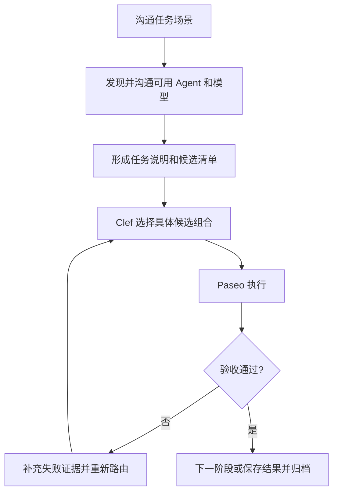

# Ray Paseo Clef Agent

一个通过本地 Clef 选择 Agent 和模型、通过 Paseo 执行任务的技能，覆盖编码、研究和写作。默认质量优先，在满足任务质量要求后，再比较速度和可核对成本。

Clef 从已发现、已授权的候选组合中选择执行程序、模型和推理档位。主 Agent 负责初始化沟通、任务规划、调用决策接口、调度和验收。

## 工作流程



每次调用先初始化，已有回答和授权直接复用，只询问会改变执行方向的缺失信息。

1. **明确场景**：目标、输入、工作目录、交付物、验收标准和操作范围。
2. **明确候选**：通过 Paseo 发现主机、执行程序、模型、工具及推理选项，再结合用户偏好确定候选池。
3. **实际路由**：把当前阶段、能力证据和候选摘要发给 Clef，读取候选 ID 和概率分布，并按快照取得完整执行配置。
4. **执行与验收**：通过 Paseo 创建或复用会话，读取实际产物并验证；有新证据时重新路由，保留选择和覆盖记录。

用户指定组合或只有一个合格候选时直接使用，并记录选择来源；没有合格候选时先解决能力缺口。Clef 故障时明确报告降级，用户要求必须由 Clef 决策时先恢复服务。

## 使用前提

- 支持读取 `SKILL.md` 的管理 Agent，以及可用的 Paseo MCP 或 CLI。
- 管理 Agent 能读取配套的 `paseo` 技能，并访问其当前接口定义。
- 一个已运行的 Clef 决策服务，支持 `POST /v1/systemone`。例如 Ollama 的本地服务；使用前核验版本、模型 ID 和响应。
- 至少一个可用且获授权的执行程序及模型。存在两个及以上候选时，Clef 才需要做组合选择。

这是技能说明和协议约定，执行依赖管理 Agent 实际调用工具。仓库没有独立的常驻调度进程，也不包含 Paseo、模型权重或供应商凭据。

## 安装

以 Codex 的个人技能目录为例：

```sh
git clone https://github.com/huruizhi/ray-paseo-clef-agent.git \
  "${CODEX_HOME:-$HOME/.codex}/skills/ray-paseo-clef-agent"
```

如果目标目录已存在，先检查它是 Git checkout 还是此前手动安装的副本，保留本地改动后再更新。Git checkout 可在该目录运行 `git pull --ff-only`。

将 Paseo 提供的 `paseo` 技能安装到管理 Agent 可发现的位置，并按所用客户端的技能刷新方式加载本技能。

## 调用

```text
使用 $ray-paseo-clef-agent 完成这项任务：
为现有项目修复一个跨文件回归问题，补充能复现问题的行为验证。
先沟通场景和可用的 Agent、模型，再让 Clef 选择具体执行组合。
质量优先。先串行执行。
```

研究和写作任务同样需要描述预期产物，例如“根据官方资料整理选型比较”或“根据已确认的大纲和材料完成文章”。执行阶段使用相应专业技能；它们由管理 Agent 的环境提供。

## 本地 Clef 示例

以下命令适用于已安装并启动 Ollama 的环境。下载会占用磁盘空间；模型、运行时和硬件要求以 [Ollama 模型页](https://ollama.com/library/clef-flash:9b-mxfp8) 为准。

```sh
ollama pull clef-flash:9b-mxfp8
```

接口连通性检查：

```sh
curl http://localhost:11434/v1/systemone \
  -H 'Content-Type: application/json' \
  -d '{
    "model": "clef-flash:9b-mxfp8",
    "state": "The customer was charged twice and requests a refund.",
    "questions": {
      "refund": {
        "type": "noul",
        "instructions": "Is the customer requesting a refund?"
      }
    }
  }'
```

这只验证决策服务。实际 Agent 分配使用 `choice` 选择候选 ID，完整输入和校验规则见 [Clef 路由说明](references/clef-routing.md)。服务地址、模型及具体执行模型均在初始化时发现或由用户指定。

## 文件

| 路径 | 用途 |
| --- | --- |
| [SKILL.md](SKILL.md) | 初始化、候选发现、路由、执行、验收及归档流程 |
| [references/clef-routing.md](references/clef-routing.md) | Clef 请求示例、响应检查、候选选择及反馈规则 |
| [agents/openai.yaml](agents/openai.yaml) | 技能显示名称和简介 |

任务记录按需保存在用户本机的 `~/.config/ray-paseo-clef-agent/`，与本仓库分开。记录去除凭据及无关私人材料。

## 验证范围

技能格式和相对引用已经检查；示例候选请求已通过本地 Clef 调用，能返回候选 ID 和完整概率分布。该检查未创建执行 Agent。

完整跨 Agent 的实际任务验收、不同候选的选择质量和成本收益尚未完成系统评估。候选概率不等于任务成功率；按阶段验收结果积累证据，再调整路由策略。
